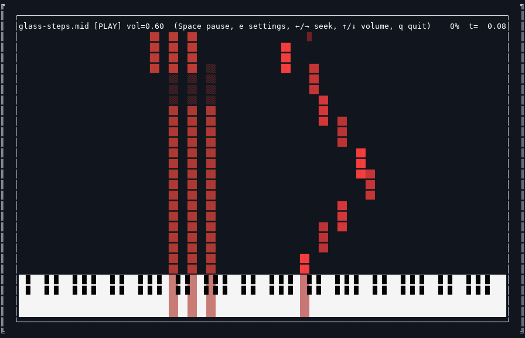

# Synthermia

Terminal Synthesia-style MIDI visualizer with SoundFont playback, live MIDI input, and deep TUI customization.



Supported platform: Linux. Live input uses ALSA; desktop media controls use
MPRIS over the session D-Bus. Windows is unsupported, and macOS is untested.

## Installation

To run from a source checkout without building the optional native extension:

```bash
git clone <repository-url> synthermia
cd synthermia
python3 -m venv .venv
source .venv/bin/activate
python -m pip install -r requirements.txt
python main.py --help
python main.py examples/glass-steps.mid --range 36:84
```

Replace `<repository-url>` with the URL of this repository. The bundled sample
runs without a SoundFont or audio tools. Omit the MIDI argument to open settings.

To install the application and native extension from this checkout, install a
Rust toolchain first, then run `python -m pip install .`. This installs the
`synthermia` command and supports `python -m synthermia`. Installing a prebuilt
wheel requires Python 3.10+ and does not require Rust:

```bash
python -m pip install /path/to/synthermia-0.1.0-*.whl
synthermia --help
```

No MIDI files or SoundFonts are downloaded automatically. Visualization works
without audio; optional feature dependencies are listed below.

## Dependencies

Required (core app):
- Python 3.10+
- A UTF-8 terminal with ANSI color support

The full keyboard needs at least 108 terminal columns. Use `--range 21:60` for a
narrower display. Playback recalculates its layout when the terminal is resized;
if the selected layout no longer fits, it exits with the required dimensions.

Required for SoundFont audio:
- A SoundFont file (`.sf2` / `.sf3`)

Required for in-process audio engine (`--audio-engine python`, default):
- `pyFluidSynth` Python module (`pip install pyfluidsynth` or distro equivalent)
- System `libfluidsynth`

Required for the CLI audio engine and MP3 export:
- FluidSynth runtime (`fluidsynth` CLI)

Required for live MIDI input mode:
- `aseqdump` from `alsa-utils`

Optional (better auto-latency probing/logs):
- `pw-dump` (PipeWire tools)
- `pactl` (PulseAudio/PipeWire Pulse compatibility)

Optional (MP3 export from TUI):
- `ffmpeg`

Optional (native packed playback acceleration for very large MIDIs):
- Rust toolchain
- `maturin` for local extension builds

Optional (desktop/headphone media controls):
- A Linux desktop session with a D-Bus session bus

## Quick Start

Try the bundled original sample (visualization only):

```bash
python3 main.py examples/glass-steps.mid --range 36:84
```

`Glass Steps` is an original 16-second, two-track piano piece distributed under
this repository's MIT license. The range above fits an 80-column terminal and
shows every note in the sample. The preview shows the full keyboard in a
112-column terminal. Add `--soundfont /path/to/piano.sf2` to hear it.

Launch the interactive TUI config screen (pick MIDI, SoundFont, and settings):

```bash
python3 main.py
```

If you already use `uv` and `mise`:

```bash
mise x -- uv run main.py
```

This installs the project, including the native extension, and requires Rust
for a local build. The source-checkout instructions above avoid that build.

Or launch directly with your own MIDI file:

```bash
python3 main.py midis/your_file.mid --soundfont Steinway_D-274.sf2
```

List live MIDI input ports:

```bash
python3 main.py --list-midi-input-ports
```

Live MIDI input mode:

```bash
python3 main.py --midi-input-mode --soundfont Steinway_D-274.sf2
```

## TUI Config Screen

Running with no arguments opens an interactive configuration screen (curses TUI) where you can:
- Pick a MIDI file and SoundFont(s)
- Press `/` to filter settings by name, and `p` to start playback from any setting; picker filters hand off to results with arrow keys
- Configure audio engine, driver, output device, gain, and buffer settings
- Set per-track colors, instruments, and volume overrides with auto-matching to SoundFont presets
- Adjust visual parameters (rows, scales, glyphs, colors, pedal options)
- Export the current MIDI + SoundFont to MP3 (requires `ffmpeg`)
- Preview instruments with a built-in demo player (`d` key in any instrument picker)

Settings and profiles are saved in `$XDG_CONFIG_HOME/synthermia/` (default:
`~/.config/synthermia/`) as `last_config.json` and `profiles.json`. Writes are
atomic and failures are reported. MIDI and SoundFont paths are stored as absolute
paths so settings work from other directories. Existing `.synthermia_last_config.json`
and `.synthermia_profiles.json` files in the launch directory are read when the
corresponding user config file does not exist; the next save uses the user config
directory and leaves the old files untouched.

## Features

- Terminal piano-roll rendering with Unicode glyphs
- Multi-track parsing with tempo map, time signatures, controls, and note span generation
- Stuck-note mitigation modes (`auto`, `off`, `lifo`) for imperfect MIDI files
- Optional long-note cleanup that caps malformed note durations without extending ordinary notes
- Optional measure bars in playfield
- Pedal visualization (dotted hold tails) with independent pedal opacity scaling and configurable fade decay
- Velocity-based note transparency (dynamics visualization)
- Per-track color overrides, instrument overrides (SoundFont bank/program), volume overrides (track gain multipliers); track colors can use freeform RGB or a named ANSI-16 palette, whose automatic choices avoid background and piano-key colors
- Instrument picker demos (`d`) in every instrument selector (main, track, live-map)
- Auto-match MIDI track names/instrument names to SoundFont presets using fuzzy similarity
- Keyboard scaling controls (`rows`, `x_scale`, keyboard Y scale, black key extra rows)
- Color Rendering lets notes, pedal tails, and piano keys independently use truecolor or the terminal theme's ANSI-16 palette, and configures the automatic or custom terminal background
- Off-piano ornamental background with toggle to plain background
- Pressed-key color modes: `split` (splits the key between multiple colors), `weighted` (calculates an average color), `off`
- SoundFont playback with two engines: Python in-process (`pyFluidSynth`) and CLI (`fluidsynth` subprocess)
- Audio backend settings (driver, output device, gain, period size, periods, sample rate)
- Optional audio logging with timestamps (`--audio-log`)
- Runtime playback controls: pause, seek, volume adjust, settings, quit
- Optional desktop/headphone media controls through MPRIS: pause, seek, and volume
- MIDI pitch mirror (`--midi-flip`) for reversing note layout
- Live MIDI input mode (USB/ALSA) with upward-moving notes
- Live sustain pedal handling (including invert option)
- Live capture and save to MIDI (`s`) with CC64 pedal events preserved
- Live instrument hotkey mapping (change instrument while playing)
- MP3 export via TUI (FluidSynth renders to WAV, `ffmpeg` encodes to MP3)

MIDI formats 0 and 1 with a positive ticks-per-quarter-note time division are
supported. Format 2 and SMPTE timing are unsupported. Malformed headers, track
chunks, event data, and tempo values are reported as input errors in both loaders.

## Runtime Controls

Standard playback:
- `Space`: pause/resume
- `e` (while paused): open settings / config screen
- `Left` / `Right`: seek -/+ 5s
- `Up` / `Down`: audio gain
- `q`: quit

On a Linux desktop session, Synthermia publishes MPRIS media controls for pause, seek, and volume.

Live input mode:
- `s`: save captured MIDI
- `Up` / `Down`: audio gain
- instrument hotkeys (configured in TUI): switch instrument + color
- `q`: quit

## CLI (Main)

Use `python3 main.py -h` for full options. Main groups:

- **Input**: MIDI file path, live MIDI mode + port + save dir + pedal invert + live mapping strings
- **Audio**: engine, FluidSynth binary, driver, output device (`--audio-output`), gain, period size/periods/sample rate, SoundFont (`--soundfont`), SoundFont library (`--soundfonts`), bank/program
- **Playback**: fps, rows, drop speed, speed, start, range, stuck-note-fix, long-note threshold/duration, midi-flip, playback-engine
- **Visual**: glyphs, note/pedal/piano color modes, dynamics threshold, pedal dots/opacity/decay, measure bars, keyboard scale, piano visibility, colors, terminal background, ascii-ui

## Optional Native Acceleration

Synthermia can run entirely in pure Python, but it now has an optional packed playback path aimed at very large MIDI files.

- `--playback-engine python`: force the legacy Python object path
- `--playback-engine packed`: use packed window queries and prefer the native extension when available
- `--playback-engine auto`: default; switches to the packed path for larger MIDI files

If the native extension is not installed, Synthermia falls back to a Python packed representation instead of failing.

To build the extension locally, install a Rust toolchain and activate the Python
virtual environment created above. `requirements.txt` includes `maturin`:

```bash
maturin develop
```

## Development Checks

```bash
python3 -m py_compile main.py synthermia/*.py
python3 -m unittest discover -v
cargo check --locked
maturin develop
SYNTHERMIA_REQUIRE_NATIVE=1 python3 -m unittest discover -v
maturin build --release --locked --out dist
python3 tools/check_wheel.py dist/synthermia-0.1.0-*.whl
```

Tests cover export subprocesses, seek state, controller routing, settings
persistence, terminal restoration, malformed MIDI, Python/native equivalence,
and background packed loading. The wheel check installs into a temporary
environment and checks both launch commands outside the checkout. CI runs the
suite on Python 3.10 and 3.14 and verifies a wheel built from the source archive.

To regenerate the sample, run `python3 -m tools.generate_sample`. To record the
10-second terminal preview, install the optional recording dependencies with
`python3 -m pip install Pillow pyte`, then run `python3 tools/record_demo.py`.
The recorder uses a temporary settings directory and leaves personal settings
untouched. Use `--font /path/to/monospace.ttf` if DejaVu Sans Mono is unavailable.

The code and bundled sample are distributed under the [MIT license](LICENSE).
SoundFonts and any other MIDI files you supply retain their own licenses.
